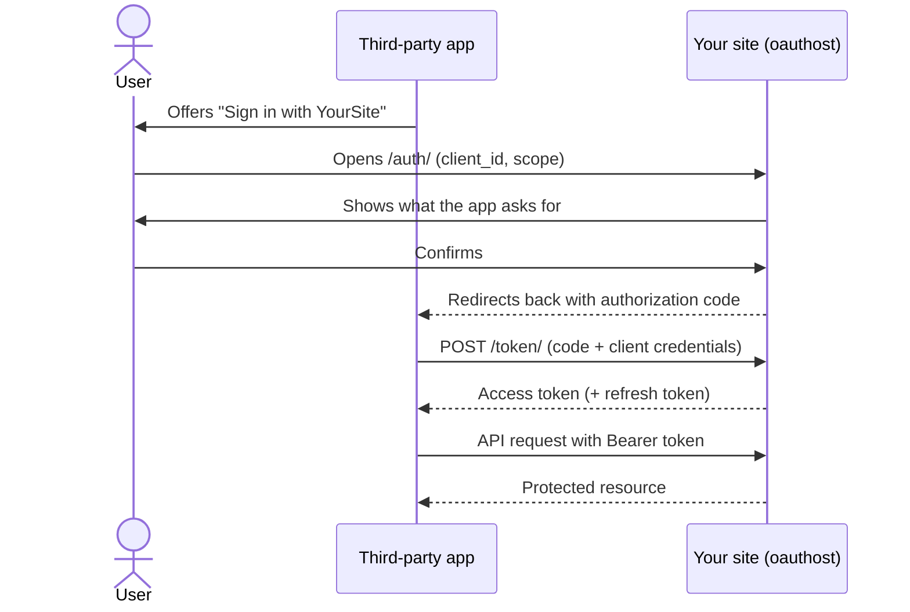
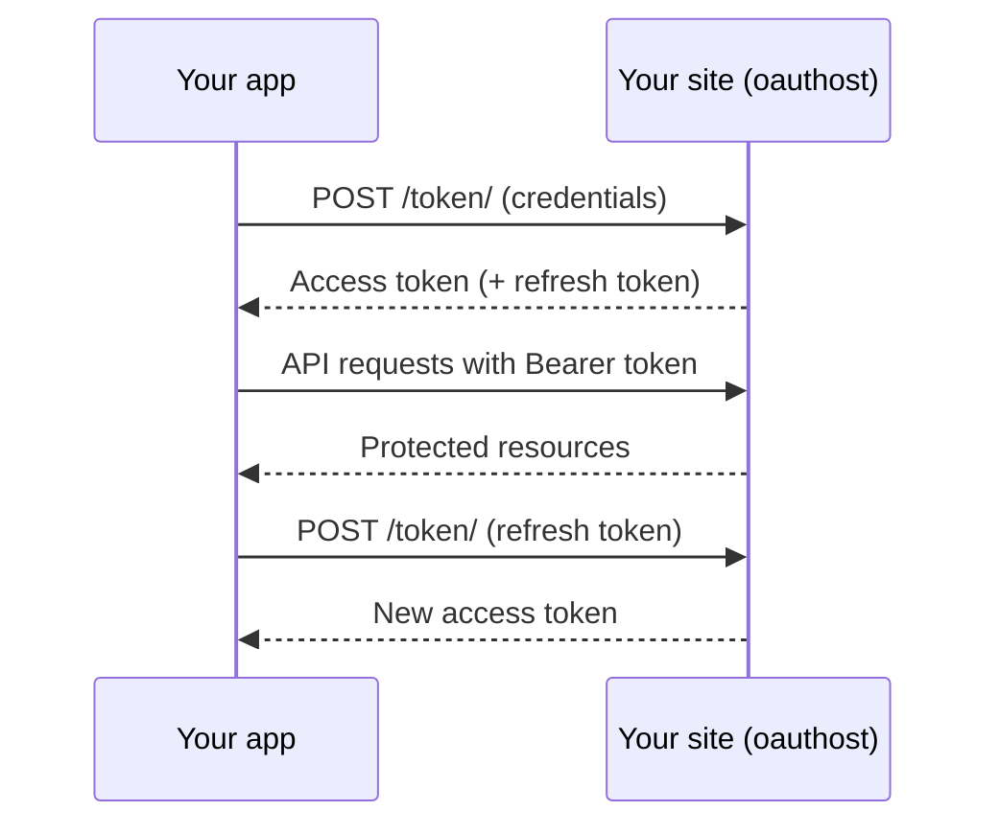

# Usage scenarios

This page explains in plain words what oauthost does and when it can be useful.

## What oauthost is

oauthost turns your Django website into an **OAuth 2.0 authorization server**.
That means your site can issue **access tokens**, so that applications —
your own ones or third-party — are able to access your site's resources
on behalf of your users, without knowing user passwords.

!!! note "What oauthost is NOT"

    oauthost is not an OAuth client. It can not sign your users in
    via Google, GitHub or another external provider. It only *issues*
    access, it does not *consume* access issued elsewhere.

## Terms in plain words

* **Client** — an application that wants access to your resources.
  Registered once, gets its own identifier (and a secret, if it can keep one).

* **Scope** — a named permission, e.g. `polls:vote`.
  A token is limited to the scopes it was issued with.

* **Authorization code** — a short-lived string your site gives to a user
  who agreed to share access. The client exchanges it for a token.

* **Access token** — a string the client presents with every request
  to prove it is allowed in. Expires after a while.

* **Refresh token** — a string the client uses to get a new access token
  without bothering the user again.

## Scenario 1: A third-party app accesses your API

You want partners to build apps on top of your website: mobile clients,
integrations, "Sign in with YourSite" buttons. Users stay in control —
they see what the app asks for and approve it on your site.



How to set it up: [Quick start](010_quickstart.md) — register a client,
then let it use the *authorization code* grant.

## Scenario 2: Your own app talks to your own backend

You have a single-page application or a mobile app, and your Django site
is its backend. Sessions and cookies fit poorly here — tokens fit well.
The mechanics are the same as in Scenario 1, but the client is yours,
so you may simplify the flow (e.g. issue tokens right from Django Admin).



How to set it up: [Quick start](010_quickstart.md) — register a client
and pick a grant type that suits your app.

## Scenario 3: Token-protected views instead of sessions

You want some views of your Django project to require a token rather
than a logged-in session — e.g. an API next to your regular pages.
Decorate a view with `@oauth_required`, and it answers only to requests
carrying a valid token with a sufficient scope:

```python
from oauthost.decorators import oauth_required

@oauth_required(scope='polls:vote')
def vote(request, poll_id):
    ...
```

See [Helpers](020_helpers.md) for details.

## What does not fit

* **Social login for your users** ("Sign in with Google") — oauthost
  is a server, not a client. Look at client-side libraries instead.

* **Separate resource server** — if the protected site (A) and the
  authorization site (B) are different projects not sharing a database,
  site A needs a way to check tokens issued by site B. oauthost currently
  checks tokens against its own database only.
